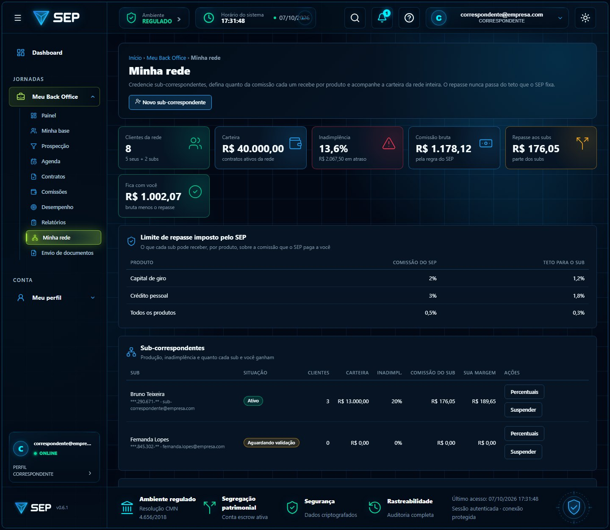
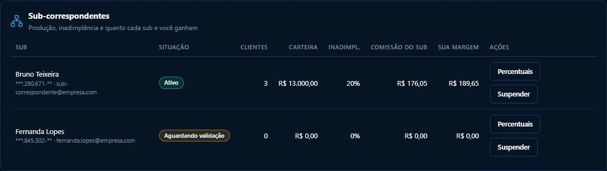
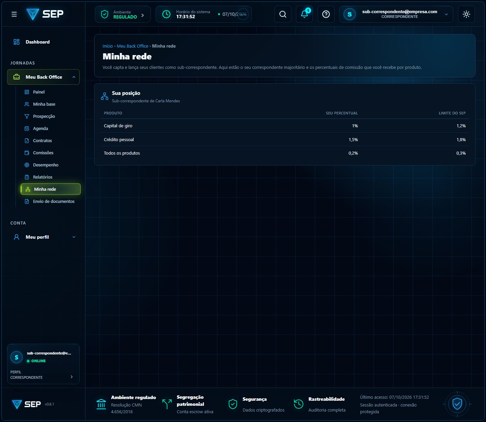
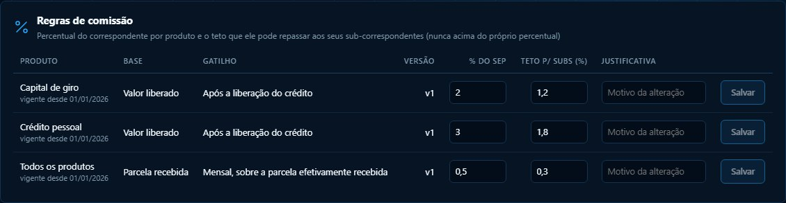
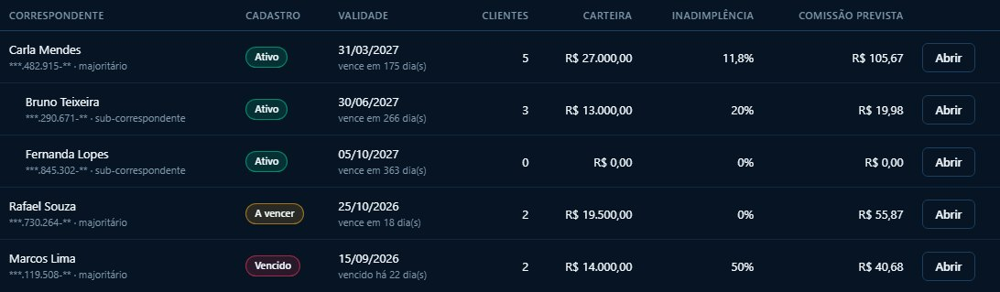

# Módulo 2 · Rede de sub-correspondentes

**Contrato detalhado:** [`CONTRATO_BACKEND_CORRESPONDENTES.md`](../../atualizacao-07102026/CONTRATO_BACKEND_CORRESPONDENTES.md), seções 20 e 21.

## Por que existe no fluxo do SEP

Um correspondente majoritário tem alcance limitado. A rede de subs deixa ele **credenciar outros captadores**, que lançam clientes
sob a responsabilidade dele, e **repassar uma parte da comissão** a cada um, sempre abaixo de um **teto que o SEP fixa por produto**.
Isso amplia a capilaridade comercial sem o SEP perder o controle do quanto paga. A rede tem **um nível só**: sub não credencia sub.

## Telas

| Tela | Imagem |
| --- | --- |
| Minha rede (majoritário) |  |
| Subs credenciados e percentuais |  |
| Posição do sub (o que ele vê) |  |
| Teto de repasse por produto (administração) |  |
| Hierarquia da rede |  |

## Regra que o backend precisa garantir

Para cada comissão de um cliente do sub, com `bruta = base × percentual da regra`:

- comissão do sub = `base × percentual do sub`;
- margem do majoritário = `bruta − comissão do sub` (lançamento `MARGEM_SUB`).

A soma dos dois **é igual à comissão bruta**, evento a evento. Se o teto baixar depois, o que já foi lançado **não muda**. Estorno
estorna as duas pontas. Repasse acima do `tetoSub` é recusado com 422.

## Isolamento

O majoritário vê a própria carteira e a de **seus** subs. O sub vê **só** a própria carteira e comissão, o nome do majoritário e os
próprios percentuais; nunca a margem do majoritário nem outro sub (403 ou 404).

## Responsabilidades

| Front (Daniel) | Backend (Maurício) |
| --- | --- |
| Telas de rede, formulário de credenciamento, status `PENDENTE`/`ATIVO`/`SUSPENSO` | `nivel`, `majoritarioId`, `tetoSub`, `PercentualSub`, validação de teto, status do sub |
| Mostrar só o que cada papel pode ver | Garantir o isolamento nas consultas |
| Justificativa obrigatória ao alterar percentuais | Auditar `SUB_CRIADO`, `PERCENTUAIS_SUB_ALTERADOS`, `SUB_SUSPENSO`, `SUB_REATIVADO` |

## Estado no `sep-api`

Sem módulo de correspondentes, a rede também não existe. Depende do módulo 1.

## Em aberto

Natureza da relação majoritário e sub (pode exigir cadastro e validação do sub pelo SEP, que o front trata como `PENDENTE`), quem
paga a comissão do sub (implicação fiscal e de retenção) e a responsabilidade do majoritário pela documentação enviada pelos subs.
