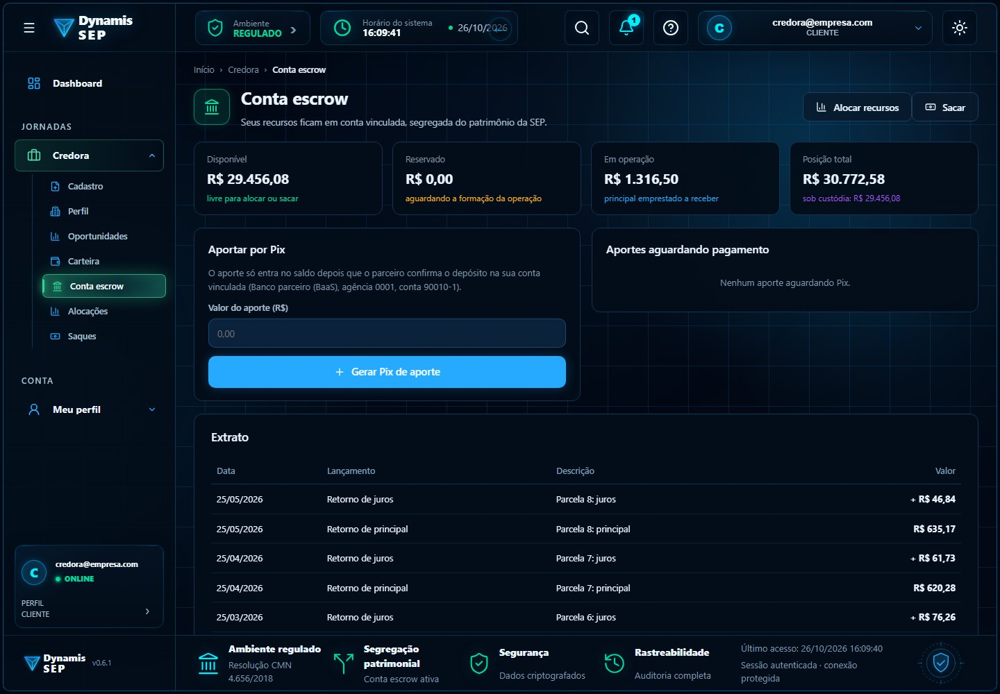
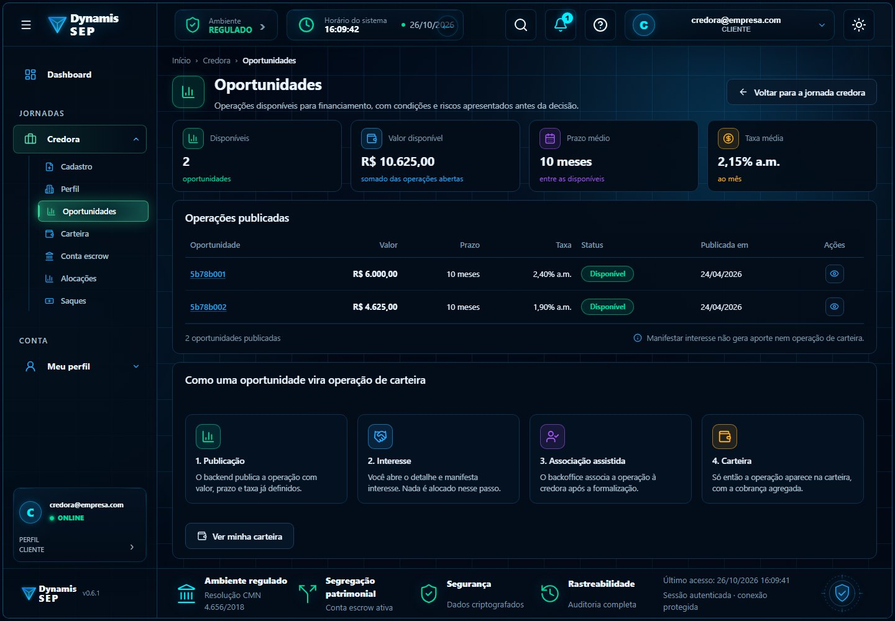
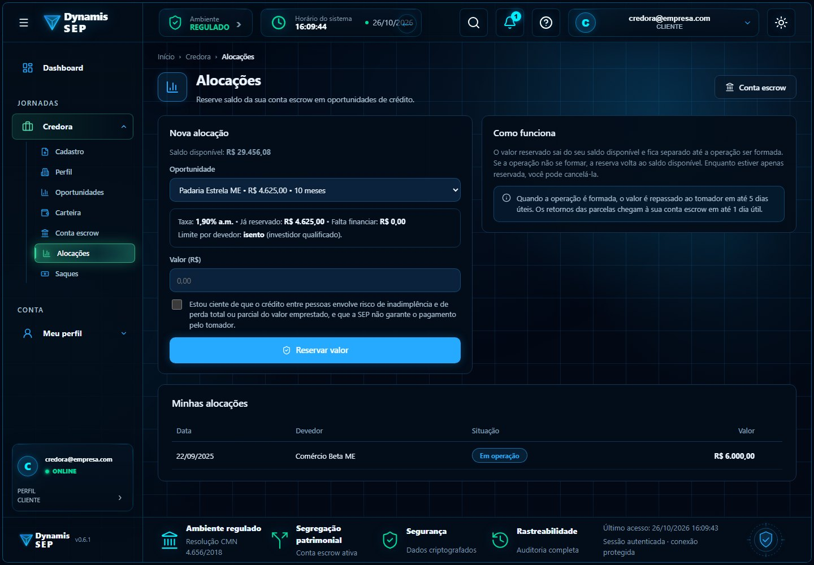
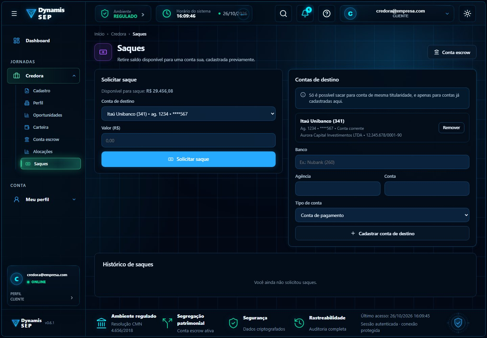
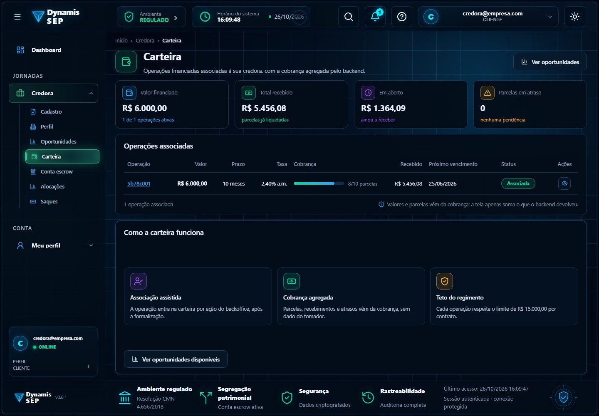
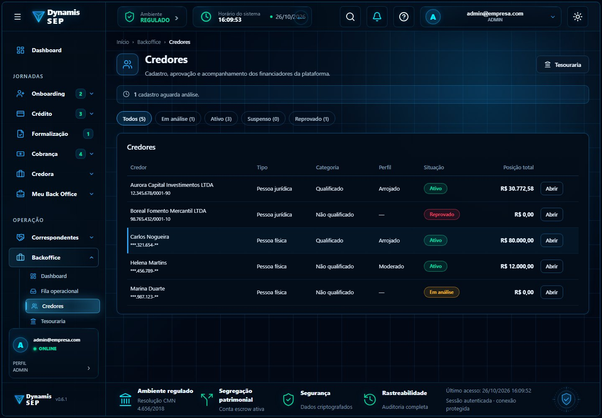
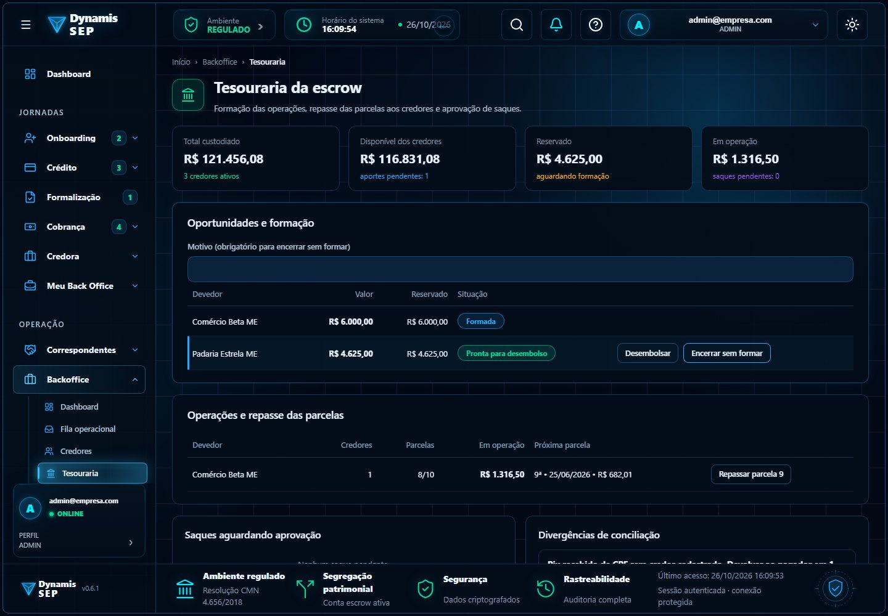

# Módulo 3 · Credores e conta escrow

**Contrato detalhado:** [`ESCROW_CREDORES_CONTRATO_BACKEND.md`](../../backend/ESCROW_CREDORES_CONTRATO_BACKEND.md) (267 linhas) e a análise
[`GESTAO_DO_CREDOR_2026-10-08.md`](../../analise-credor/GESTAO_DO_CREDOR_2026-10-08.md). Os testes do store do mock
(`src/mocks/data/credores-escrow.store.spec.ts`, 45 testes) e do livro-razão (`escrow-ledger.spec.ts`) são a especificação executável:
o backend deve passar nos mesmos casos.

## Por que existe no fluxo do SEP

O SEP é uma sociedade de empréstimo **entre pessoas**: o dinheiro emprestado vem de **credores**. Para isso ser seguro e
regulado, o dinheiro do credor não passa pelo caixa do SEP: fica numa **conta escrow** (vinculada, na Celcoin), segregada do
patrimônio da empresa. Este módulo é o coração financeiro do fluxo: o credor aporta, aloca em uma operação, o SEP forma e
desembolsa, e cada parcela paga pelo tomador volta ao credor (principal e juros), com prazos do regimento. Sem ele não há como
mostrar rastreabilidade nem segregação patrimonial.

O saldo **nunca é digitado**: é sempre a soma dos lançamentos de um livro-razão imutável. Erro se corrige com estorno, nunca com edição.

## Telas

| Tela | Imagem |
| --- | --- |
| Conta escrow da credora: saldo, aporte por Pix, extrato |  |
| Oportunidades abertas à alocação |  |
| Alocações |  |
| Saques com destinatário previamente cadastrado |  |
| Carteira |  |
| Gestão de credores (backoffice) |  |
| Tesouraria: formar operação, repassar parcela, aprovar saque |  |

## O que o front já faz (Daniel)

- Fluxo completo do credor: aporte por Pix, alocação com ciência de risco, limite por devedor, cancelamento de reserva, destinatários e saque.
- Tesouraria: formar a operação (só quando as reservas cobrem 100%), desembolsar, encerrar sem formar, repassar parcela e aprovar saque.
- Gestão de credores: status (`EM_ANALISE`, `ATIVO`, `SUSPENSO`, `REPROVADO`), perfil de risco, categoria e auditoria.
- Rateio da parcela entre os credores, principal e juros separados, método do maior resto, soma exata ao centavo (`escrow-ledger.ts`).

## O que o backend precisa fazer (Maurício)

1. **Livro-razão** imutável com os baldes `DISPONIVEL`, `RESERVADO`, `EM_OPERACAO` e `EXTERNO` e os tipos de lançamento do contrato (seção 2).
2. **Regras do regimento:** repasse ao devedor em até 5 dias úteis (art. 21), retorno ao credor em até 1 dia útil após cada parcela paga,
   ciência de risco em toda alocação (art. 20, IX), perfil de risco alterável só pelo backoffice (art. 28), qualificado exige termo (Res. CVM 30/2021).
3. **Saque:** só para destinatário previamente cadastrado e de mesma titularidade; **maker-checker real** (quem solicita não aprova, `403`).
4. **Idempotência** (`Idempotency-Key`) em aporte, alocação, saque, aprovação, desembolso e repasse; chave com hash do corpo; corpo diferente com a mesma chave → 422; janela de 24 h; mais **chave de negócio única** por lançamento (`operacaoId + parcela + tipo`).
5. **Step-up (TOTP)** nas operações de dinheiro: saque, aprovação, desembolso, repasse e mudança de status.
6. **Integração Celcoin:** conta vinculada, Pix de aporte, webhook de confirmação, transferência de saque (seção 7.3 do contrato).
7. **Auditoria** de toda escrita e, no que for sensível, de leitura; rate limit nas rotas de dinheiro.

**Rotas (prefixo `/api/v1`):** `/credores/me/escrow`, `/escrow/extrato`, `/escrow/aportes`, `/alocacoes`, `/destinatarios`, `/saques`,
`/limites/{oportunidadeId}`; tesouraria em `/backoffice/tesouraria/*`; gestão em `/backoffice/credores/*`. A tabela completa com
papéis, corpos e respostas está nas seções 5.1 a 5.3 do contrato.

> `POST /credores/me/escrow/aportes/{id}/simular-confirmacao` **só existe no mock**: simula o webhook da Celcoin. No real, o aporte só
> entra no saldo quando o parceiro confirma.

## Estado no `sep-api`

- `credores` já tem matching, carteira, oportunidades, aportes por operação e interesses.
- `escrow` tem o domínio (conta, wallet, movimentação) e o provedor (Celcoin e fake) com casos de uso de reconciliação e movimentação, mas
  **não tem endpoints REST**.
- O front **não** usa os caminhos atuais do `credores` (matching e `/credores/oportunidades`), que são os do MVP; a convergência precisa
  decidir se o front aponta para eles ou se o backend expõe os caminhos `/credores/me/*` do contrato.

## Ordem sugerida de implementação (contrato, seção 11)

1. Livro-razão, saldo, extrato e `GET /credores/me/escrow*`. 2. Aporte com webhook Celcoin (sandbox) e idempotência. 3. Oportunidades, alocação,
limite e cancelamento. 4. Gestão de credores. 5. Desembolso, encerramento e devolução. 6. Repasse de parcela ligado ao pagamento confirmado do
tomador. 7. Saque com maker-checker e step-up. 8. Conciliação, divergências e relatórios regulatórios.

## Em aberto

Perguntas para a Celcoin (seção 9), para o jurídico (seção 10) e decisões da própria SEP (seção 8): dias úteis e feriados, prazo de carência
no cadastro de destinatário, limites e categorias de credor.
