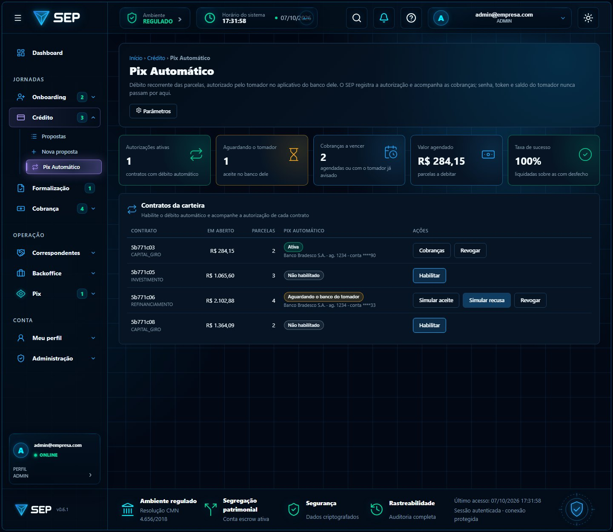
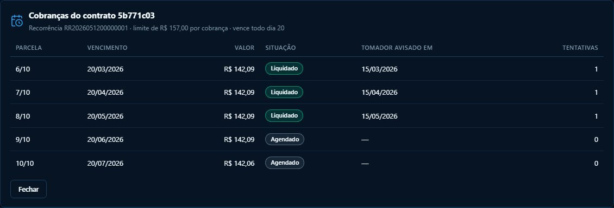

# Módulo 4 · Pix Automático

**Documento de referência:** [`VIABILIDADE_PIX_AUTOMATICO.md`](../../atualizacao-07102026/VIABILIDADE_PIX_AUTOMATICO.md).

## Por que existe no fluxo do SEP

A inadimplência nasce, muitas vezes, do esquecimento: o tomador precisa lembrar de pagar cada parcela. O **Pix Automático** é o
"débito automático via Pix": o tomador autoriza **uma vez** no banco dele, o SEP envia cada cobrança e o banco debita na data. O SEP
ganha previsibilidade de recebimento, o tomador ganha comodidade, e o repasse aos credores (módulo 3) passa a ter data confiável.

Dois recursos parecidos não são a mesma coisa. O **Pix Agendado** é um pagamento único marcado pelo pagador, e não serve para parcelas.
O **Pix Automático** é a recorrência autorizada, e é o que o produto precisa; por isso o nome na tela é "Pix Automático".

## Telas

| Tela | Imagem |
| --- | --- |
| Contratos com a situação da autorização e as ações Habilitar, Cobranças e Revogar |  |
| Cobranças por parcela: agendada, tomador avisado, liquidada, falhou, cancelada |  |

## O que o front já faz (Daniel)

Tela `/app/credito/pix-automatico` (BACKOFFICE, FINANCEIRO, ADMIN) com indicadores, cadastro dos dados do pagador com consentimento
registrado (LGPD), cobranças por parcela e, para ADMIN, chave geral e parâmetros (dias de aviso, tentativas) com justificativa e
auditoria. Os botões "Simular aceite/recusa" existem **só na demonstração**.

Regra de habilitação: com a chave geral desligada nada é habilitado; por contrato exige parcela em aberto, consentimento e dados completos.

## O que o backend precisa fazer (Maurício)

1. **Escolher o parceiro** (PSP/banco com a API de Pix Automático para recebedor): decisão de negócio, bloqueia todo o resto.
2. **Estados da recorrência**, incluindo `PENDENTE_PAGADOR`: o aceite acontece **no banco do tomador**, o SEP nunca ativa sozinho, e as
   cobranças só são geradas depois do aceite.
3. **Cobrança por parcela:** aviso ao pagador antes do vencimento (a tela usa 2 a 10 dias, parametrizável), reapresentação após falha (1 a 3)
   e cancelamento. Confirmar os números no regulamento do BCB com o parceiro e o compliance.
4. **Dados e segurança:** criptografar documento e conta em repouso, devolver **mascarados**, nunca guardar senha, token do banco, saldo ou
   extrato. Nenhuma cobrança acima de R$ 15.000 (teto do regimento por operação).
5. **Auditoria** de criação, revogação e alteração de parâmetros; webhook de liquidação ligado ao módulo de recebimentos do Pix.

**Rotas:** todas sob `/api/v1/pix-automatico` (`/parametros`, contratos, pagador, cobranças); tabela completa na seção 5 do documento de referência.

## Estado no `sep-api`

Só existem Pix de chaves, desembolsos e recebimentos. Não há recorrência nem cobrança por parcela.

## Em aberto

Parceiro e custos, regulamento do BCB (prazos de aviso e reapresentação), cancelamento pelo pagador e o impacto no score (ver módulo 5: o
site anuncia um benefício a quem tem o Pix Automático ativo).
