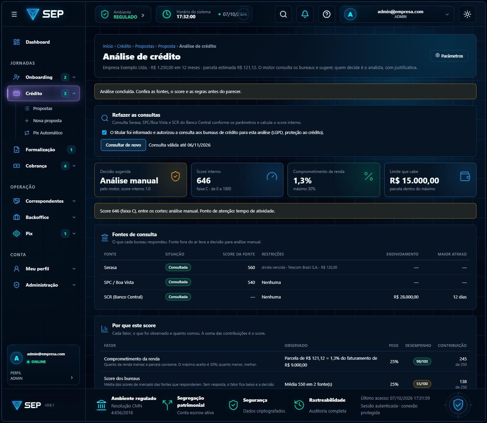
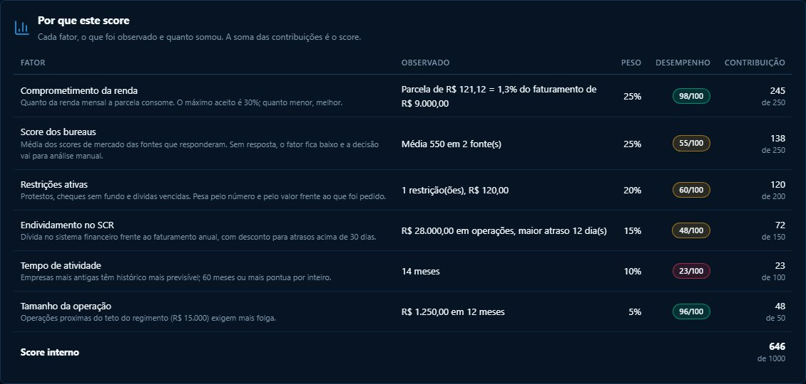
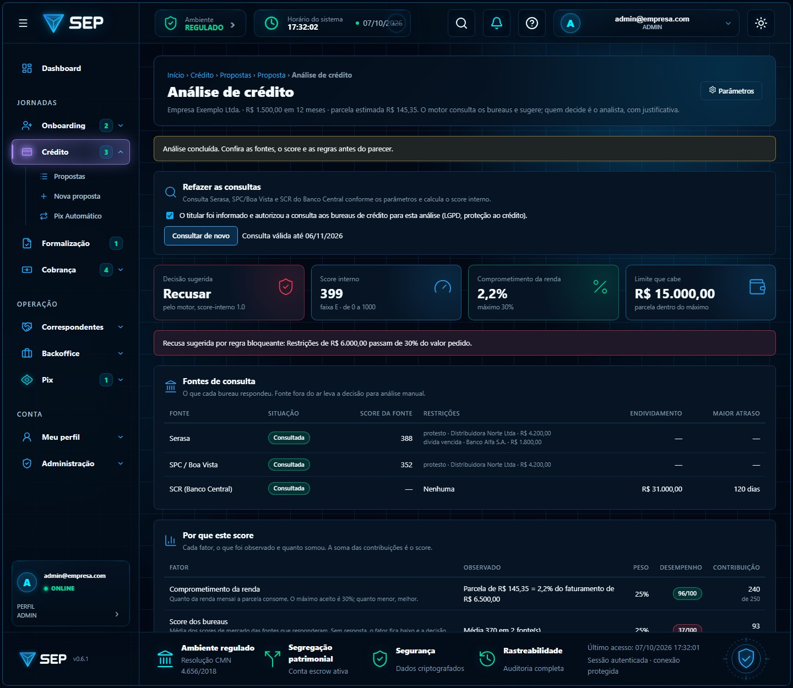

# Módulo 5 · Análise de crédito (bureaus e score interno explicável)

**Documento de referência:** [`ANALISE_DE_CREDITO.md`](../../atualizacao-07102026/ANALISE_DE_CREDITO.md).

## Por que existe no fluxo do SEP

Antes de o dinheiro de um credor ser alocado a um tomador, alguém precisa dizer **quanto risco há e por quê**. Hoje o parecer depende só da
leitura do analista. O módulo dá a ele uma base objetiva: consulta às fontes de crédito, um **score interno de 0 a 1000 que mostra a conta**,
a capacidade de pagamento e uma decisão sugerida. O analista continua decidindo (direito de revisão humana, art. 20 da LGPD), e divergir do
motor exige justificativa.

A **explicabilidade** é a regra central: a soma das contribuições dos fatores é exatamente o score, e a tela mostra cada parcela da conta.

## Telas

| Tela | Imagem |
| --- | --- |
| Resultado da análise: decisão sugerida, score e faixa |  |
| Fatores do score, com peso, desempenho e contribuição |  |
| Recusa por regra bloqueante |  |

## O que o front já faz (Daniel)

Consulta a Serasa, SPC/Boa Vista e SCR (simuladas), score com seis fatores (comprometimento da renda 25%, bureaus 25%, restrições 20%,
endividamento no SCR 15%, tempo de atividade 10%, tamanho da operação 5%), ajuste do Pix Automático (padrão +30), capacidade de pagamento
e limite que cabe (Price, com teto de R$ 15.000), regras bloqueantes e de atenção, decisão sugerida e parecer do analista.

## O que o backend precisa fazer (Maurício)

1. **Contratos e credenciais** com os bureaus. O SCR exige adesão e autorização específicas do BACEN.
2. **Consentimento do titular** na requisição (base legal de proteção ao crédito); sem ele, 400. Registrar quem consultou, quando e para quê.
3. **Reaproveitar a consulta** dentro da validade (1 a 90 dias, padrão 30); só refazer com `forcar`.
4. **Motor de score no backend** (o front não calcula nem altera). A resposta traz `fatores[]`, `ajustes[]` e a conta fechando
   (`fatores + ajustes = score`, limitado a 1.000).
5. **Regras de decisão:** bloqueantes recusam (valor acima de R$ 15.000, restrições acima de 30% do valor, atraso acima de 90 dias no SCR);
   atenção manda para análise manual (fonte habilitada indisponível, parcela acima do comprometimento máximo).
6. **Parâmetros** só por ADMIN, com justificativa e auditoria.
7. **Dados de entrada reais:** faturamento e tempo de atividade vêm de um perfil fictício; no real, do Open Finance, do KYB e dos documentos.

**Rotas (`/api/v1/credito`):** `GET` e `PUT /analise/parametros`, `GET` e `POST /propostas/{id}/analise`, `POST /propostas/{id}/analise/parecer`.
Erros: 400 sem consentimento, 409 sem fonte habilitada ou sem análise para o parecer, 422 fora dos limites ou divergência sem justificativa.

## Estado no `sep-api`

`credito` já tem propostas, regras, parecer e Open Finance (webhook). **Não** tem consulta a bureaus, score interno nem capacidade de pagamento.

## Em aberto

Calibração dos pesos e cortes com a carteira real (os atuais são de demonstração), monitoramento de viés e deriva, política de retenção das consultas.
