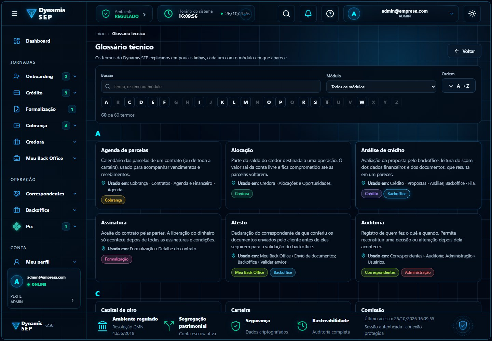

# Módulo 6 · Glossário técnico e ajuda

## Por que existe no fluxo do SEP

O SEP junta vocabulário financeiro, regulatório e operacional (escrow, atesto, maker-checker, step-up, rateio...). Quem entra no
sistema, seja credor, correspondente, analista ou administrador, precisa entender os termos **no próprio lugar onde eles aparecem**.
O glossário reduz suporte, evita decisão errada por mal-entendido e serve de base comum entre as áreas.

## Telas

| Tela | Imagem |
| --- | --- |
| Glossário técnico: 60 termos, busca, filtro por módulo e ordem A→Z |  |

## Como funciona

- Menu Ajuda › Glossário (`/app/glossario`). Cada termo traz uma explicação curta, **onde ele é usado** (módulo e tela) e o selo do módulo.
- Busca por termo, resumo ou módulo; filtro por módulo; ordem A→Z; índice alfabético que desativa as letras sem termo.
- Existe um tour assistido do glossário.

## Responsabilidades

| Front (Daniel) | Backend (Maurício) |
| --- | --- |
| Conteúdo e telas (`glossario.data.ts`, com teste de integridade dos dados) | Nada: é conteúdo estático do front |

## Observação para o backend

Os termos descrevem regras que o backend implementa (por exemplo, "maker-checker", "idempotência", "rateio"). **Se uma regra mudar no
backend, o verbete precisa mudar junto**: avise o front para manter o glossário fiel ao sistema.
