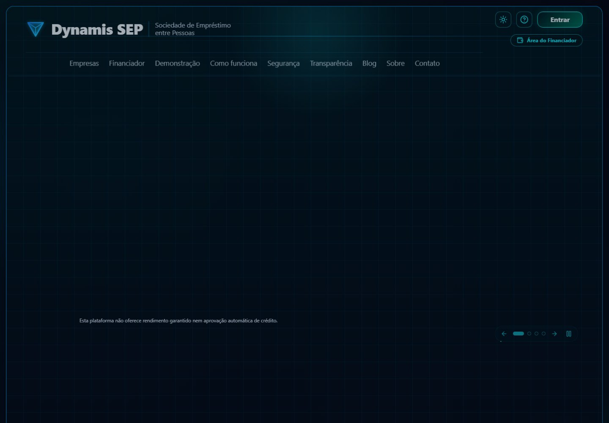
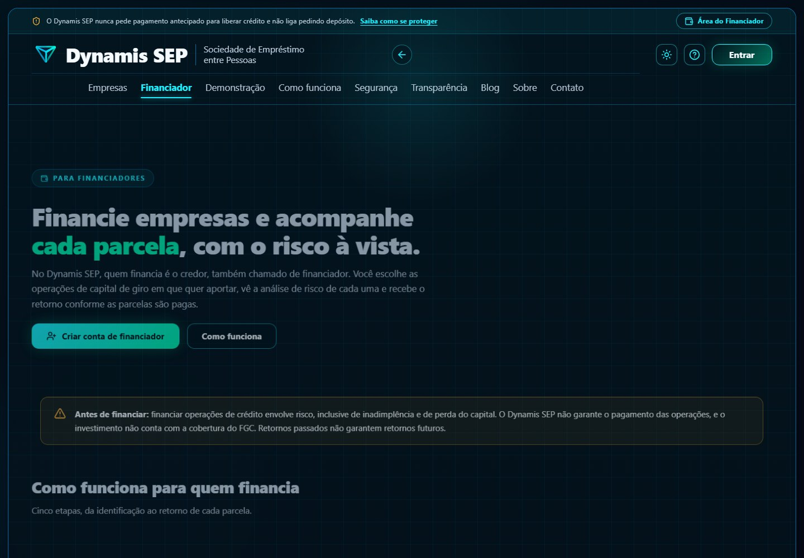
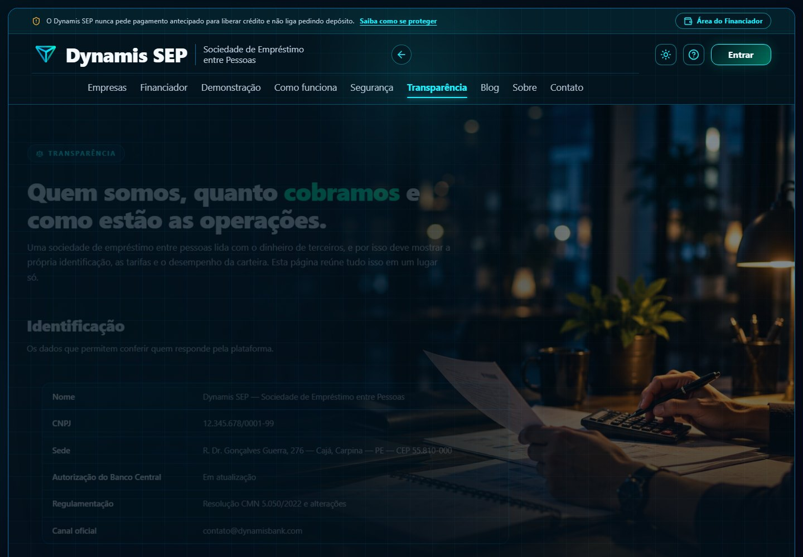
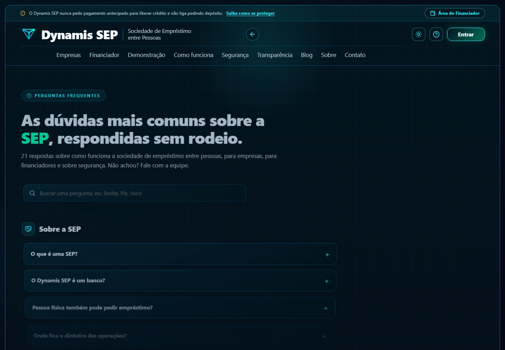
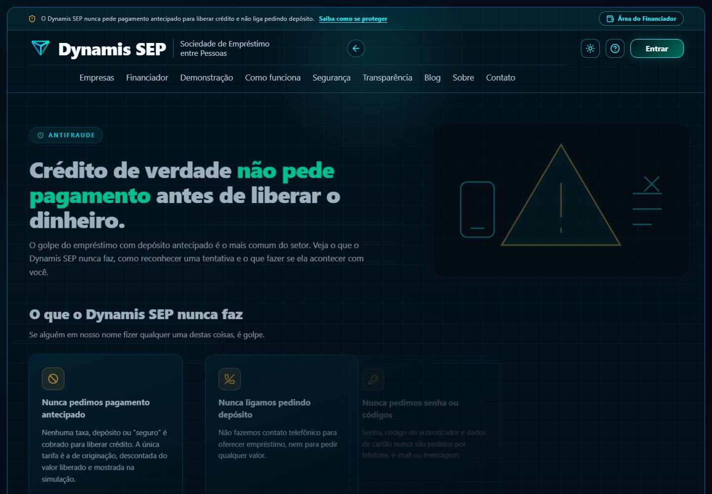
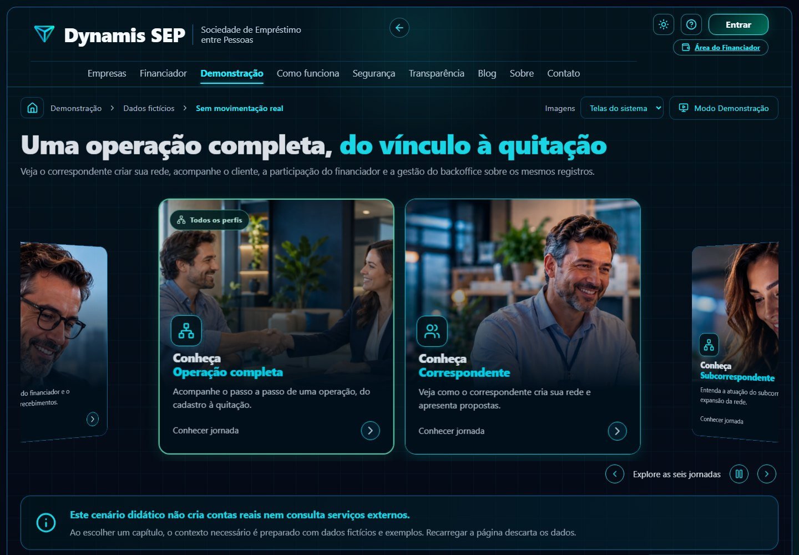

# Módulo 7 · Site público, blog e demonstração

## Por que existe no fluxo do SEP

O fluxo do SEP começa **antes do cadastro**: o visitante precisa entender o que é uma sociedade de empréstimo entre pessoas, que o SEP
não é banco nem investimento garantido, onde fica o dinheiro e como se proteger de golpes. O site público faz essa ponte e atende três
públicos: quem busca crédito (empresas e pessoas físicas), quem quer financiar (investidores) e quem quer conhecer o produto
(demonstração). A **transparência** e o **antifraude** são parte da confiança que o regulador e o credor exigem.

## Telas

| Tela | Imagem |
| --- | --- |
| Página inicial |  |
| Investidores |  |
| Blog |  |
| Transparência |  |
| Perguntas frequentes |  |
| Antifraude |  |
| Demonstração |  |

## O que o front faz (Daniel)

- Páginas institucionais: como funciona, segurança, sobre, contato, termos de uso, política de privacidade, crédito PJ, investidores,
  perguntas frequentes, transparência e antifraude.
- **Blog** com leitura em áudio sincronizada, diagramação em 1, 2 ou 3 colunas e volta automática à lista.
- **Demonstração:** a operação completa percorrida pelos perfis (correspondente, sub-correspondente, backoffice, tomador, análise, credor,
  contrato, desembolso e quitação) em **tour assistido**, com dados fictícios que recomeçam a cada execução.
- Fotos de banner e blog em JPG, fundos das páginas em WebP e banners da demonstração em WebP com PNG de reserva; as fotos são geradas por IA e levam o rótulo "Imagem ilustrativa".

## O que o backend precisa fazer (Maurício)

**Nada para a demonstração:** ela roda inteira no front com o MSW e **precisa permanecer em ambiente fictício** (ver
`00-responsabilidades-e-ambientes.md`). Dois pontos de atenção:

1. **Textos do site que afirmam regras do produto** (prazos, limites, ajuste de score do Pix Automático, taxas) devem ser conferidos com o
   que o backend aplicar: o site não pode prometer o que o sistema não cumpre.
2. **Blog:** hoje é conteúdo do front. Se for preciso editar sem deploy, o backend pode expor uma API de conteúdo; é uma decisão futura, não bloqueia nada.

## Estado no `sep-api`

Não se aplica.

## Em aberto

Publicação do site (domínio, HTTPS, cabeçalhos de segurança), política de cookies convergida com o MVP (o MVP já tem o aviso) e o relatório de
segurança público (`public/relatorio-seguranca`).
