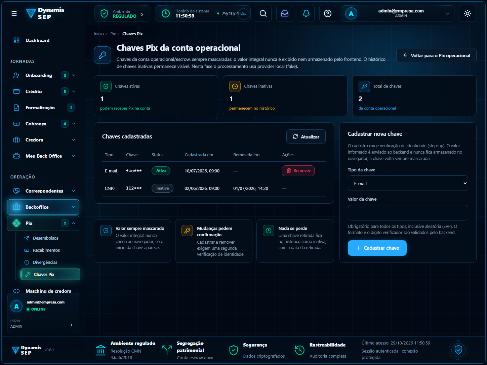
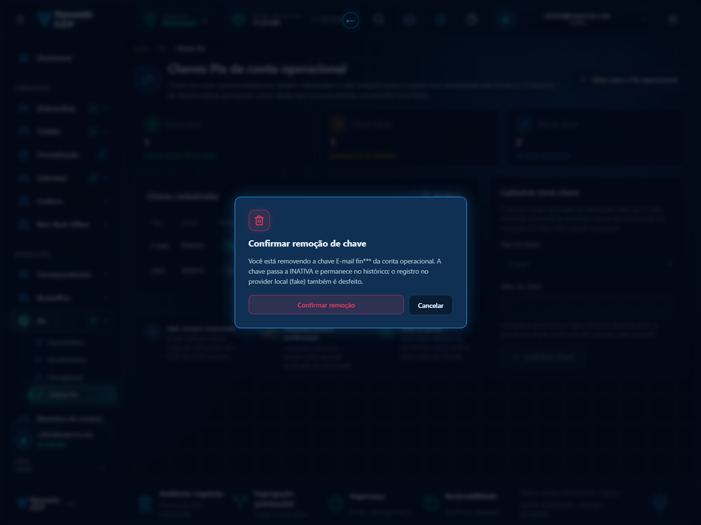
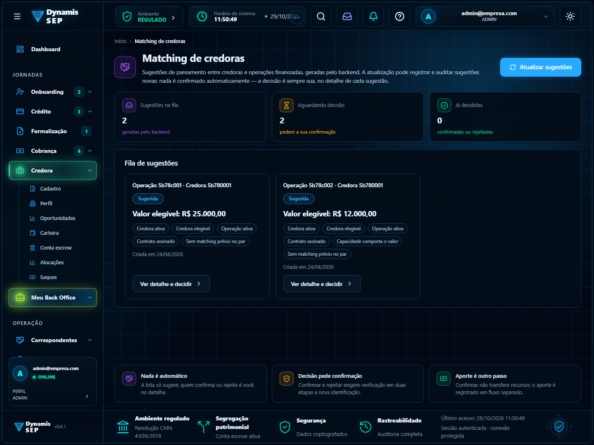
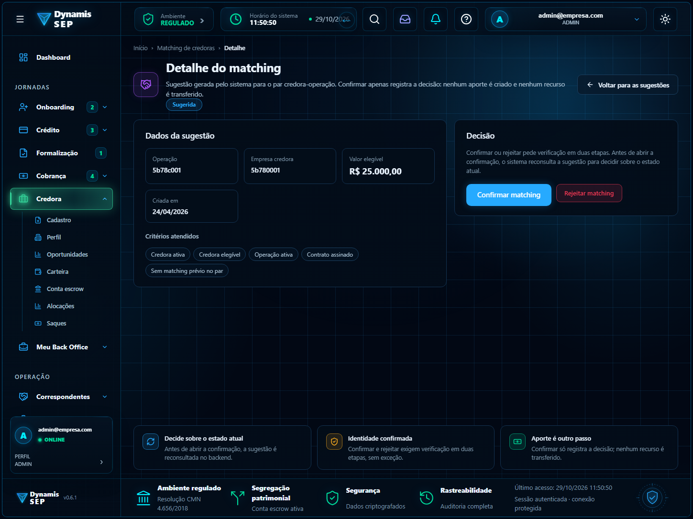
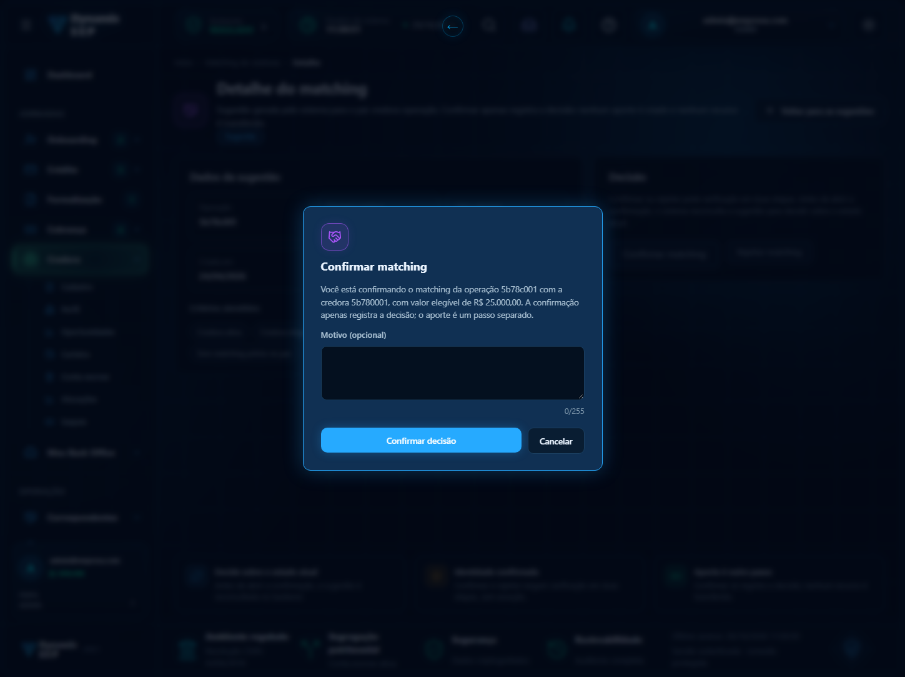
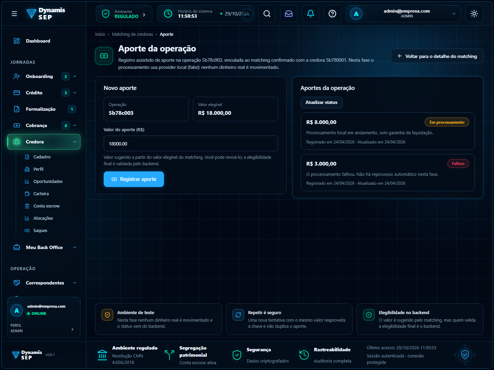

# Módulo 8 · Chaves Pix e Matching de credoras

**Data:** 29/10/2026 · **Origem:** telas que vieram do MVP (sprints 18 e 20) e que, depois da convergência, ainda
estavam no desenho antigo. Agora seguem o mesmo layout e o mesmo enquadramento das demais telas operacionais.

## Por que existem no fluxo do SEP

- **Chaves Pix.** O SEP envia e recebe dinheiro por uma conta operacional/escrow. As chaves dessa conta são o que
  permite receber Pix. Quem cuida delas é o financeiro e a administração, e cada mudança (cadastrar ou remover)
  é sensível: por isso pede verificação em duas etapas.
- **Matching de credoras.** O backend sugere o pareamento entre uma credora e uma operação financiada. A sugestão
  **nunca** é confirmada sozinha: uma pessoa do financeiro ou da administração decide, no detalhe. Confirmar só
  registra a decisão; o aporte é um passo separado.

## Telas

Caminho no sistema, com o login de financeiro ou administrador:

| Tela | Como chegar | Imagem |
| --- | --- | --- |
| Chaves Pix | Menu **Pix** → submenu **Chaves Pix** (`/app/pix/chaves`) |  |
| Remoção de chave (confirmação) | Chaves Pix → **Remover** numa chave ativa |  |
| Matching, fila de sugestões | Menu **Matching de credoras**, em Operação (`/app/credora/matching`) |  |
| Matching, detalhe | Fila → **Ver detalhe e decidir** |  |
| Matching, confirmação da decisão | Detalhe → **Confirmar matching** ou **Rejeitar matching** |  |
| Matching, aporte da operação | Detalhe de uma sugestão confirmada → **Registrar aporte da operação** |  |

"Matching de credoras" é um item próprio do menu de Operação, e não um submenu de Credora: Credora é o menu do papel
CLIENTE, e o matching é uma operação interna.

## O que o front já faz (Daniel)

- **Layout.** As quatro telas usam o shell operacional (menu, cabeçalho e rodapé do sistema), com trilha de
  navegação, cartões, selos, modais de confirmação e uma faixa de regras no tema. Comportamento, regras de MFA,
  *step-up* e idempotência do aporte **não mudaram**.
- **Blocos reutilizáveis.** `src/styles/_tela-operacional-blocos.scss` reúne indicadores, aviso, campos, botão de
  perigo, faixa de regras e modal. É opt-in por tela, para não mexer nas telas já aceitas.
- **Texto em português do Brasil.** Todos os textos visíveis e as mensagens de erro têm acentuação.
- **Critérios do matching.** O backend devolve códigos (por exemplo `CREDORA_ATIVA`). A tela mostra o rótulo em
  português por `rotuloCriterio()` (`credora-format.ts`); um código novo, ainda não mapeado, aparece como texto
  legível, nunca como identificador.

| Código do backend | Rótulo na tela |
| --- | --- |
| `CREDORA_ATIVA` | Credora ativa |
| `CREDORA_ELEGIVEL` | Credora elegível |
| `OPERACAO_ATIVA` | Operação ativa |
| `CONTRATO_ASSINADO` | Contrato assinado |
| `PAR_SEM_MATCHING_PREVIO` | Sem matching prévio no par |
| `CAPACIDADE_COMPORTA_VALOR` | Capacidade comporta o valor |

- **Menu lateral.** Rótulos longos ("Matching de credoras", "Correspondentes", "Meu Back Office") eram cortados
  com reticências. Agora o rótulo quebra em duas linhas e, na barra estreita (208 px), volta aos 13px que o
  bloco já previa, porque o tema global forçava 14px com `!important`. Medido em 3413, 1920, 1449, 1280, 1100 e
  900 px: nenhum rótulo cortado.
- **Ajuda do sistema.** Em `/app/pix/chaves` e `/app/credora/matching` o painel de Ajuda fala da própria tela.
- **Tour assistido.** Pix ganhou o roteiro **Chaves Pix da conta** (entra no "Módulo completo" do Pix) e há um
  módulo novo, **Matching de credoras**, com **Fila de sugestões**, **Detalhe e decisão** e o **Módulo completo**.
  Os tours são só leitura: não cadastram, não removem e não decidem nada.

## O que o backend precisa fazer (Maurício)

Os contratos já existem e o front os usa como estão:

| Uso | Endpoint |
| --- | --- |
| Listar, cadastrar e remover chaves | `GET/POST /pix/chaves` e `DELETE /pix/chaves/{id}` |
| Fila e detalhe do matching | `GET /credores/matching/sugestoes` e `GET /credores/matching/{id}` |
| Decidir o matching | `POST /credores/matching/{id}/decisao` (MFA e *step-up* estrito) |
| Aportes da operação | `GET/POST /credores/operacoes/{id}/aportes` |

Para confirmar do lado do backend:

1. Se existirem **códigos de critério além dos seis** da tabela, avisar para entrarem no mapa de rótulos.
2. Se o backend passar a devolver o rótulo pronto, o mapa do front pode sair.

## O que está em aberto

- Textos de mensagens que vêm **do mock** (`mocks/handlers.ts`) seguem sem acento até o backend real responder.
- O vão de rolagem em larguras estreitas (menos de 750 px) ainda depende do comportamento do shell, que não foi
  alterado nesta entrega.

## Validação

Lint, `lint:scss`, `format:check`, `typecheck:spec`, build, 1.592 testes unitários e os e2e `pix-chaves`,
`credora-matching`, `paineis-cabecalho` e `notificacoes` passaram em 29/10/2026. Os tours foram executados no
navegador do começo ao fim (Chaves Pix: 13 passos; Matching, módulo completo: 14 passos).
